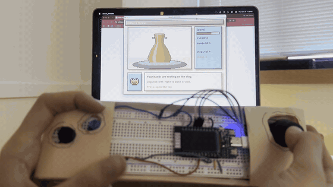
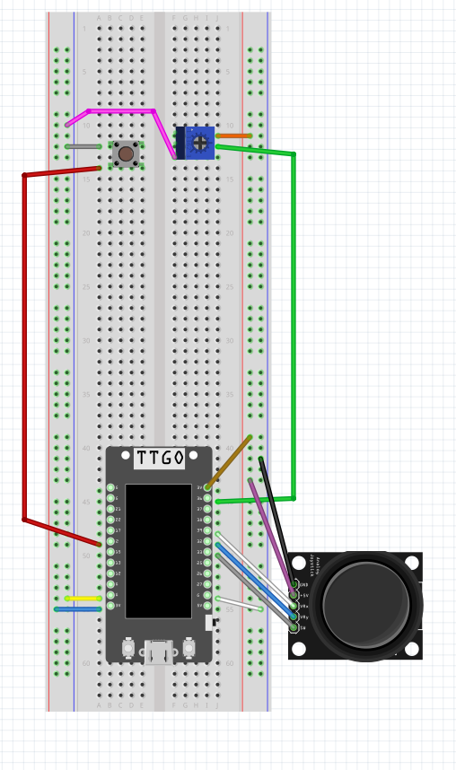

## Ribbit & Throw: Pottery Simulator - Module 2 ##

## Project Summary

This project is an interactive pottery simulator controlled by a LilyGo TTGO T-Display ESP32 with a joystick, a button, and a potentiometer. The ESP32 reads the hardware and sends it to a Processing sketch. Inspired by pottery ASMR, you place the clay on the wheel, shape it with your hands, open the top, and fire it in the kiln. The potentiometer controls the wheel speed, the joystick moves your hands and pushes or pulls the clay, the button moves to the next step, and a frog guides you through the whole process.

Link to blog: [blog post](https://ceydat709.github.io/coms3930-design-documentation/modules/module-2.html)

## Project GIF

## Source Code & Installation Instructions
To recreate this project, you will need:

Hardware:
- LilyGo TTGO T-Display ESP32 (with headers soldered)
- USB-C cable
- Breadboard
- Joystick module
- Push button
- Potentiometer
- Female-to-male wires
- Jumper wires

Other (decoration):
- Paper
- Tape

### Wiring

In case of low visibility, joystick +5V and one outer leg of the potentiometer go to 3V, and the joystick GND, the other potentiometer leg, and the other side of the button go to ground

### Setup
1. Download the Arduino IDE [here](https://www.arduino.cc/en/software)
2. Install the ESP32 boards by following the instructions [here](https://docs.espressif.com/projects/arduino-esp32/en/latest/installing.html)
3. Download Processing [here](https://processing.org/download)

### Install
1. Clone the GitHub repository
2. Open `sensor-controller/sensor-controller.ino` in the Arduino IDE
3. Plug in your TTGO T-Display with the USB-C cable
4. Go to Tools > Board > esp32 and select `ESP32 Dev Module`
5. Go to Tools > Port and select the port your board is on
6. Click Upload to upload the sketch to your TTGO T-Display
7. Close the Arduino Serial Monitor (only one program can use the port at a time)
8. Open `processing/pottery_wheel/pottery_wheel.pde` in Processing
9. Click Run, check the list of ports printed in the console, and change `Serial.list()[5]` to the number of your board's port

### Controls
- Joystick up/down: move your hands up and down the clay
- Joystick left/right: push the clay in / pull it out
- Potentiometer: wheel speed
- Button: next step (place clay, shape, open the top, fire)
- Joystick press: try a new glaze after firing

### Presentation
For the class showcase, the breadboard was placed inside a paper controller and the ESP32 was plugged into the laptop running the Processing sketch.

## References / Acknowledgments
- [Processing Serial library](https://processing.org/reference/libraries/serial/index.html)
- [coms3930-serial](https://github.com/ttseng/coms3930-serial) example code from class
- Border inspiration from [Pinterest](https://www.pinterest.com/pin/1073967842365902718/)
- Math used for the clay
    - Shaping: rings close to the hands change the most using `closeness = max(0, 1 - abs(i - handRing) / 4.0)`
    - Smoothing: each ring is blended toward the rings above and below it with [linear interpolation](https://en.wikipedia.org/wiki/Linear_interpolation) (`lerp()`)
 - Claude Code Opus 5.5 (AI support mentioned on blog page"
